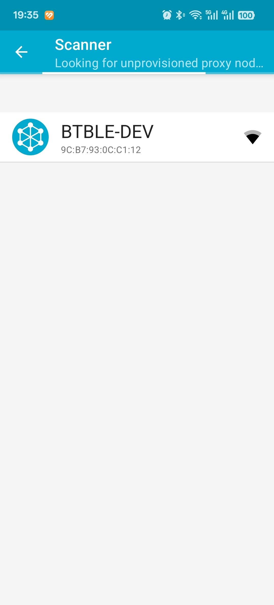
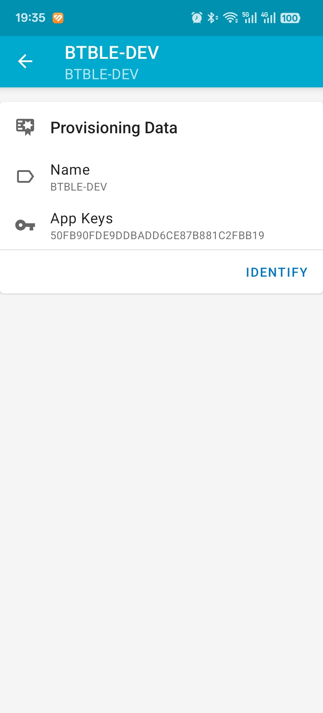
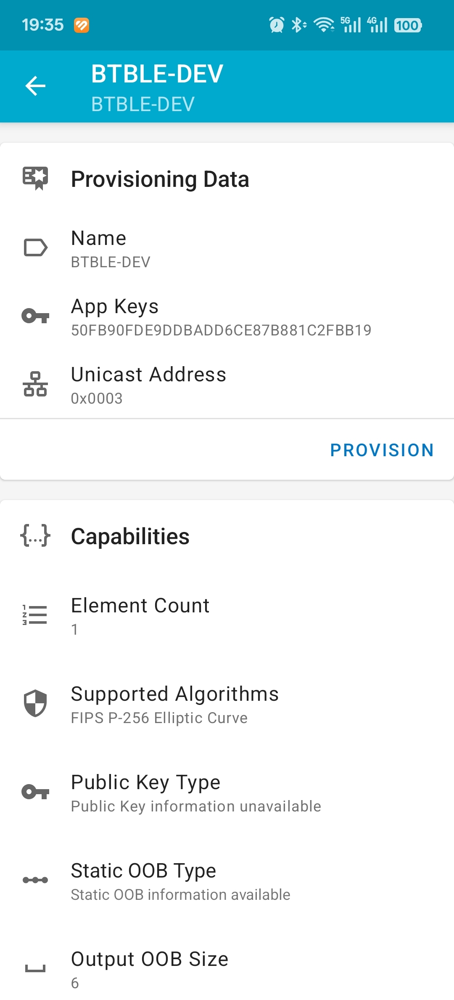
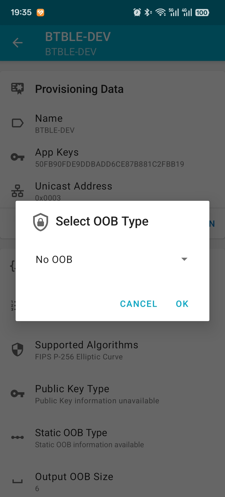
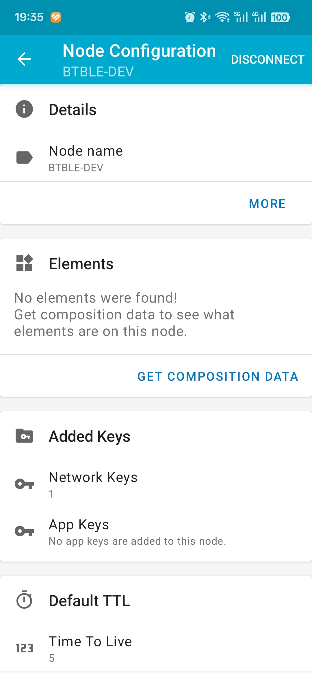
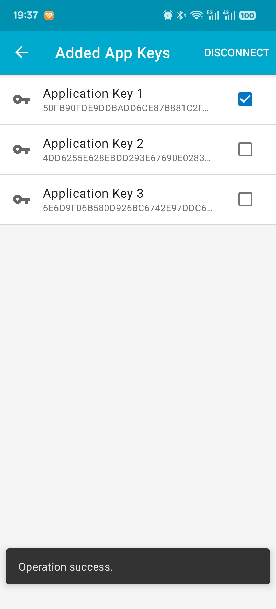
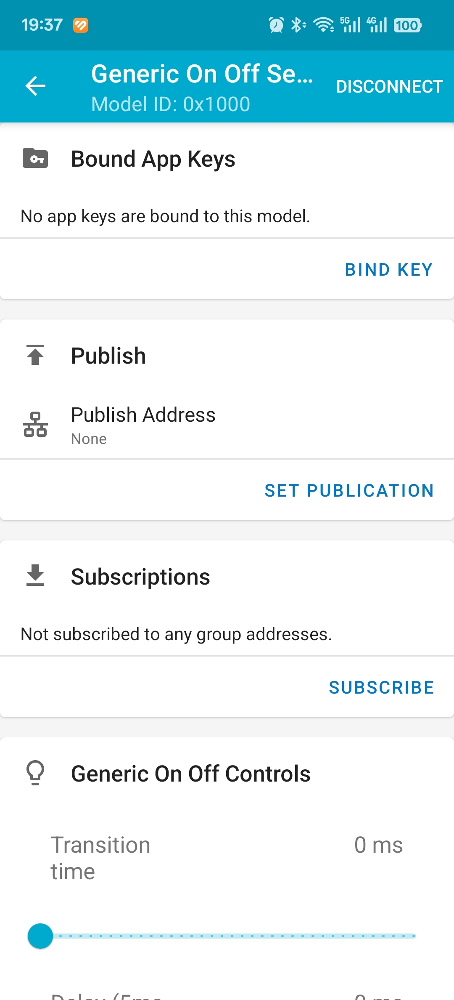
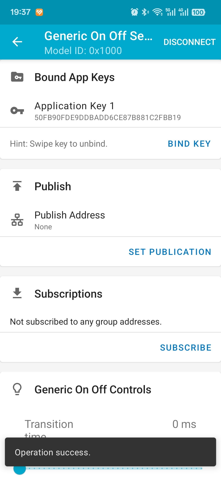

# blemesh_cli - BLE Mesh Network Command Line Example

## Description

Complete BLE Mesh network implementation supporting both Node and Provisioner modes with rich command interface. This example demonstrates comprehensive mesh functionality including provisioning, configuration, and control operations.

## Key Features

- **Dual Mode Operation**: Node and Provisioner modes
- **Mesh Network Management**: Configuration, provisioning, and control
- **Rich CLI Interface**: Comprehensive mesh command set
- **Generic On Off Server Model**: Basic mesh control functionality
- **Application Key Management**: Secure key distribution
- **Node Composition Data**: Device capability discovery
- **Group Control**: Multicast and unicast communication
-

## Support CHIP

|      CHIP        | Remark |
|:----------------:|:------:|
|qcc743/qcc744       |        |

## Compile

- qcc743/qcc744

```bash
make CHIP=qcc743 BOARD=qcc743dk
```

## Flash

```bash
make flash CHIP=chip_name COMX=xxx # xxx is your com name
```

## How to use

- Run the following mesh commands in the serial terminal

```bash
qcc74x />blemesh_init
......

qcc74x />blemesh_pb 2 1
......

```
### install NRF Mesh APP

- Open the app and select ADD NODE in the Network column

- Select your device



- Click the IDENTIFY button



- Click the PROVISION button



- Select No OOB in the pop-up window and click ok



- Add app key





- Your node is automatically added to the Network column, click on your connected device
- Locate Elements option and click it’s drop-down button, Select the Generic On Off Server option

- Click the BIND KEY button



- Click Application key 1



- Click on the ON and OFF buttons to control the LED switch
## How to use Provisioner

### Provisioner Mode Configuration

To enable Provisioner mode, add the following configuration to the `proj.conf` file:
```bash
set(CONFIG_BT_MESH_PROVISIONER 1)
```
This configuration enables the device to act as a mesh network provisioner that can add and configure other mesh nodes.

### Provisioner Usage Steps

**Provisionee Device (Node to be provisioned):**
1. Flash the blemesh_cli example without CONFIG_BT_MESH_PROVISIONER configuration
2. Run the following commands in the serial terminal:
   ```bash
   qcc74x />blemesh_init
   # Wait for initialization to complete
   
   qcc74x />blemesh_pb 2 1
   # Set device as unprovisioned node ready for provisioning
   ```
3. The device will start advertising as an unprovisioned beacon, waiting for provisioner

**Provisioner Device (Device that provisions others):**
1. Flash the blemesh_cli example with CONFIG_BT_MESH_PROVISIONER=1 in proj.conf
2. Run the following commands in the serial terminal:
   ```bash
   qcc74x />blemesh_init
   # Wait for initialization to complete
   
   qcc74x />blemesh_pb 1 1
   # Set device as provisioner
   
   qcc74x />blemesh_pvnr_init
   # Initialize provisioner mode
   # Output will show local node information:
   # Local node provisioned, net_idx 0x0000 address 0x0001
   # Network key: [network_key_value]
   # Dev key: [dev_key_value]
   # Provisioning completed
   
   qcc74x />blemesh_beacon_listen 0x01
   # Enable unprovisioned beacon listening
   # UUID information of nearby unprovisioned devices will be printed
   ```
3. Provision the unprovisioned node:
   ```bash
   qcc74x />blemesh_provision_adv <uuid> <net_idx> <addr> <duration>
   # Example: blemesh_provision_adv 000a000011112222333318b905de96c2 0 3 0
   # Parameters:
   # - uuid: UUID of the unprovisioned device (from beacon_listen output)
   # - net_idx: Network index (usually 0)
   # - addr: Unicast address to assign to the node
   # - duration: Attention duration in seconds (0 for default)
   ```
4. After successful provisioning, configure the node:
   ```bash
   qcc74x />blemesh_get_comp 0x0000 0x0003 0x00
   # Get composition data of the newly provisioned node
   # Parameters: net_idx, dst_address, page_number
   
   qcc74x />blemesh_app_key_add 0x0000 0x0003 0x0000 0x0000
   # Add application key to the node
   # Parameters: net_idx, dst_address, net_key_idx, app_key_idx
   ```
5. The provisioned node is now ready to receive mesh control commands

## Related Documentation
- Mesh Protocol Documentation:[mesh stack](../../docs/en/api_reference/ble_mesh.rst)
- Main README: [../README.md](../README.md)
